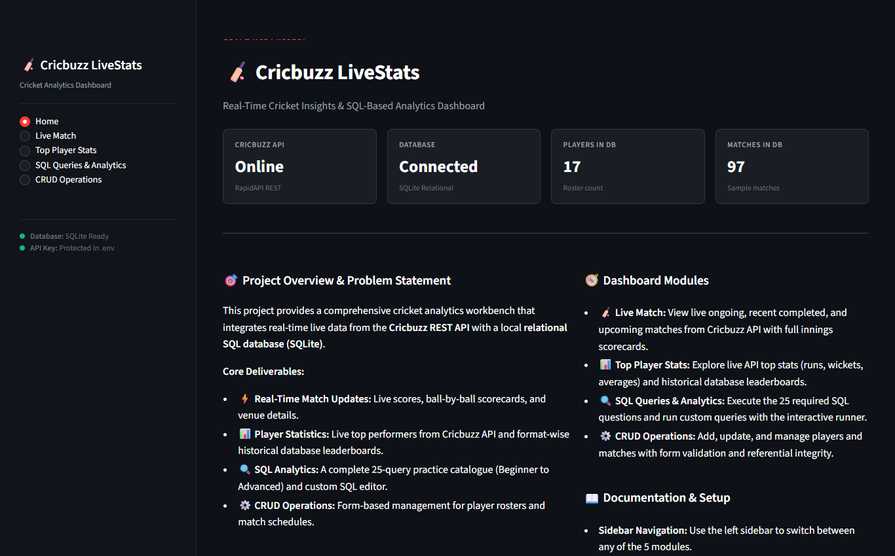
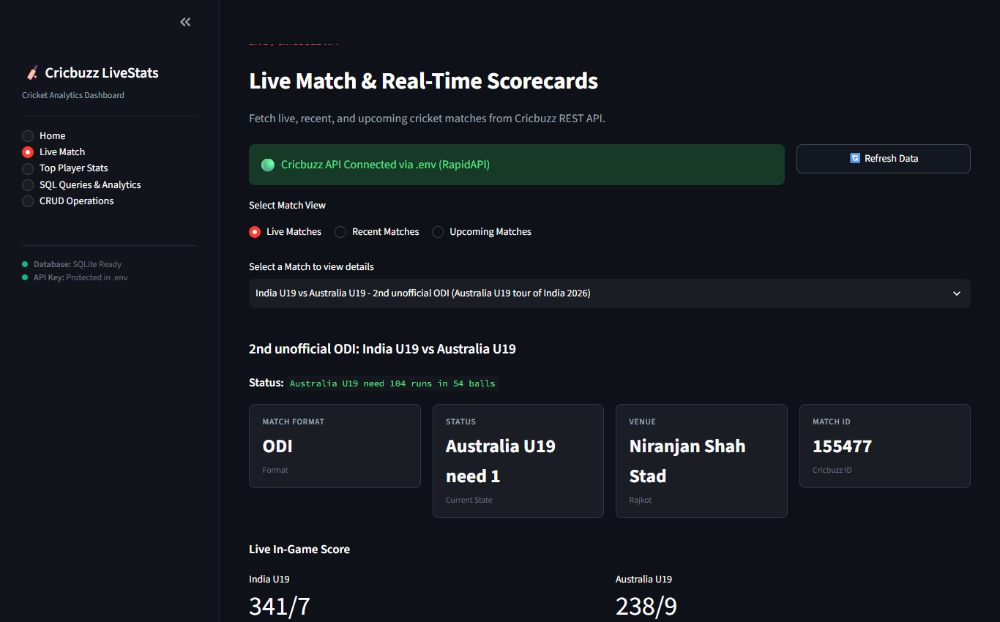
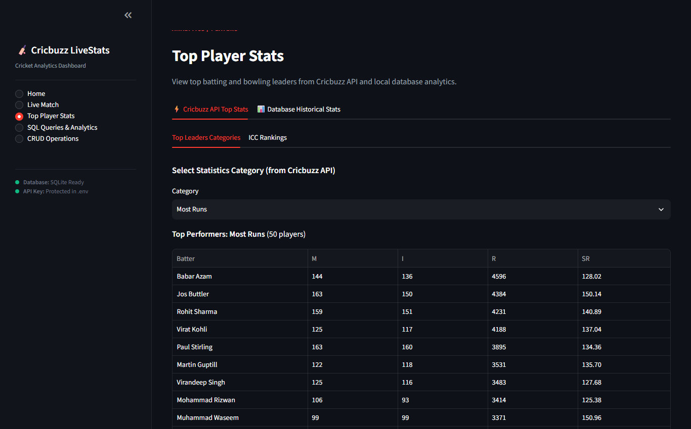
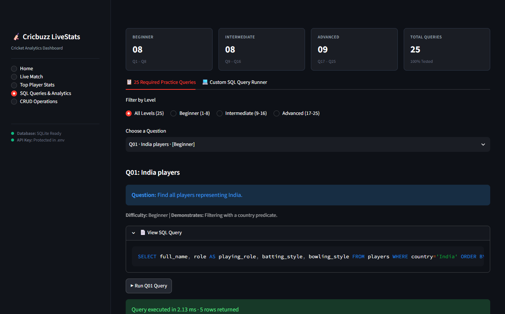
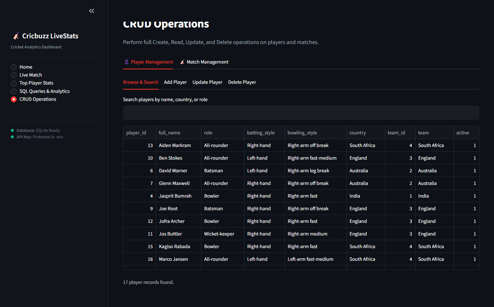

# Cricbuzz LiveStats: Real-Time Cricket Insights & SQL Analytics

A cricket analytics dashboard combining live data from the **Cricbuzz Cricket REST API** with a relational **SQLite database**, built using **Python** and **Streamlit**.

The application provides real-time match scores, top player statistics, a complete 25-question SQL analytics practice suite, and form-based CRUD operations for player rosters and match records.

---

## Project Overview & Requirements

### Problem Statement
Cricket analysts, broadcasters, fantasy leagues, and enthusiasts require timely match updates alongside deep historical statistical analysis. This project bridges both needs by combining:
1. **Live match data** fetched from the Cricbuzz Cricket REST API (via RapidAPI).
2. **Relational database storage & analytics** in SQLite for historical records, performance tracking, and complex SQL querying.
3. **An interactive multi-page web application** built with Streamlit for data exploration, query execution, and database administration.

### Key Capabilities
- **Live Match Tracking:** Ongoing match statuses, recent results, upcoming schedules, and ball-by-ball innings scorecards fetched dynamically via API.
- **Player Statistics & Leaderboards:** Live API leaderboards (Most Runs, Most Wickets, Best Strike Rate, Best Economy, ICC Rankings) and historical database player leaderboards across Test, ODI, and T20I formats.
- **SQL Analytics (25 Practice Queries):** Complete implementation of 25 structured SQL queries divided into Beginner (Q1–Q8), Intermediate (Q9–Q16), and Advanced (Q17–Q25) categories, with syntax-highlighted SQL, one-click execution, execution timers, and dynamic charts.
- **Custom SQL Query Runner:** An interactive query editor allowing users to execute custom read-only `SELECT` and `WITH` queries against the cricket schema, inspect table definitions, and export results to CSV.
- **CRUD Operations:** Dedicated forms to create, read, update, and safely delete players and matches with input validation and foreign key referential integrity protection.

### Business Use Cases (per Project Specification)
1. **Sports Media & Broadcasting:**
   - Real-time match updates for commentary teams
   - Player performance analysis for pre-match discussions
   - Historical data trends for match predictions
2. **Fantasy Cricket Platforms:**
   - Player form analysis and recent performance tracking
   - Head-to-head statistics for team selection
   - Real-time score updates for fantasy leagues
3. **Cricket Analytics Firms:**
   - Advanced statistical modeling and player evaluation
   - Performance trend analysis across different formats
   - Data-driven insights for team management
4. **Educational Institutions:**
   - Teaching database operations with real-world data
   - SQL practice with engaging cricket datasets
   - API integration and web development learning
5. **Sports Betting & Prediction:**
   - Historical performance analysis for odds calculation
   - Player form and momentum tracking
   - Venue-specific performance insights

---

## Dashboard Preview

### 1. Home / Overview
*Project overview, problem statement, live connection status, technology stack, and module guide.*


---

### 2. Live Match & Scorecards
*Live, recent, and upcoming matches retrieved from Cricbuzz API with real-time scores and detailed innings scorecards.*


---

### 3. Top Player Stats
*Cricbuzz API top performers and ICC Rankings paired with historical database leaderboards and interactive charts.*


---

### 4. SQL Queries & Analytics
*All 25 practice SQL questions organized by difficulty level with one-click execution, runtime timers, and custom query runner.*


---

### 5. CRUD Operations
*Validated form-based management for player rosters and match records with referential integrity protection.*


---

## Data Architecture & Sources

To ensure reliable performance and realistic analysis, the project separates live streaming data from persistent historical data:

| Component | Source | Purpose | Details |
| :--- | :--- | :--- | :--- |
| **Live Match Data** | Cricbuzz REST API (RapidAPI) | Real-time match scores & scorecards | Fetches live matches, recent match summaries, upcoming fixtures, and detailed batting/bowling innings scorecards. |
| **API Top Stats** | Cricbuzz REST API (RapidAPI) | Current tournament / international leaders | Fetches leading run-scorers, wicket-takers, best averages, strike rates, and official ICC rankings. |
| **Historical Data** | Local SQLite Database (`cricbuzz_livestats.db`) | Relational storage & SQL analytics | 10 normalized tables containing 97 matches, 1,164 batting performances, and 1,164 bowling performances. |
| **SQL Practice Queries** | Local SQLite Database | Academic queries (Q1 to Q25) | Powers Beginner, Intermediate, and Advanced SQL queries including multi-table joins, subqueries, and window functions. |
| **CRUD Operations** | Local SQLite Database | Database record administration | Enables adding, editing, and deleting players and matches with foreign key checks. |

*Note: The API client includes request timeout protection, Windows SSL compatibility, and graceful offline fallback handling if the API quota is exhausted or credentials are not yet configured.*

---

## Tech Stack

- **Application Framework:** Streamlit
- **Programming Language:** Python 3.10+
- **Database Engine:** SQLite3 (ANSI SQL compliant)
- **API Integration:** Requests (RapidAPI Cricbuzz Cricket REST API)
- **Data Analysis:** Pandas, NumPy
- **Data Visualization:** Plotly Express
- **Configuration & Security:** python-dotenv (environment variables, zero hardcoded secrets)
- **Testing Framework:** Pytest

---

## Project Structure

The repository is organized into modular components matching the standard layout:

```text
Cricbuzz_LiveStats_Complete_Project/
├── .streamlit/
│   └── config.toml             # Streamlit configuration and sidebar navigation settings
├── analytics/
│   ├── __init__.py
│   ├── form_analysis.py        # Player form trends and moving averages
│   ├── match_analytics.py       # Match phase run rate and margin analysis
│   └── player_analytics.py      # Batting and bowling analytical helper functions
├── api/
│   ├── __init__.py
│   └── cricbuzz_api.py         # Cricbuzz REST client (live scores, scorecards, top stats)
├── assets/
│   └── README.md               # Directory documentation for static assets
├── config/
│   ├── __init__.py
│   └── settings.py             # Environment-backed configuration and path resolution
├── data/
│   ├── .gitkeep
│   └── cricbuzz_livestats.db   # Local SQLite database (populated with historical data)
├── database/
│   ├── __init__.py
│   ├── connection.py           # Database connection manager with foreign keys enabled
│   ├── crud.py                 # Validated CRUD operations for players and matches
│   ├── schema.sql              # Relational schema (10 tables, indexes, constraints)
│   └── seed.py                 # Deterministic database seeder (97 matches, 2300+ stats)
├── docs/
│   ├── DEMO_GUIDE.md           # Step-by-step presentation and viva demonstration guide
│   ├── REQUIREMENT_AUDIT.md    # Requirement verification matrix vs PDF specification
│   ├── api_setup.md            # RapidAPI key generation and configuration instructions
│   ├── database_schema.md      # Database schema documentation and data dictionary
│   └── project_documentation.md # Detailed technical architecture and module design
├── notebooks/
│   └── data_fetching.ipynb     # Jupyter notebook demonstrating API fetching & DB insertion
├── pages/
│   ├── __init__.py
│   ├── crud_operations.py      # Player and match management interface
│   ├── live_match.py           # Live scores, recent matches, and innings scorecards
│   ├── player_stats.py         # Top player statistics (API live stats & DB leaderboards)
│   └── sql_analytics.py        # 25 SQL practice queries + interactive SQL runner
├── screenshots/
│   ├── 01_home.png             # Home / Overview screenshot
│   ├── 02_live_match.png       # Live Match & Scorecards screenshot
│   ├── 03_top_player_stats.png # Top Player Stats screenshot
│   ├── 04_sql_analytics.png    # SQL Queries & Analytics screenshot
│   └── 05_crud_operations.png  # CRUD Operations screenshot
├── sql/
│   ├── __init__.py
│   ├── queries.sql             # SQL source code for all 25 queries (Q1 to Q25)
│   └── query_metadata.py       # Query metadata catalog, categories, and chart configs
├── tests/
│   ├── __init__.py
│   ├── test_analytics.py       # Test suite for query catalog and analytical functions
│   ├── test_api.py             # Test suite for API parsing, normalization, and fallbacks
│   ├── test_crud.py            # Test suite for Player & Match CRUD operations
│   └── test_database.py        # Test suite for database schema and foreign key constraints
├── utils/
│   ├── __init__.py
│   ├── db_connection.py        # Centralized database query and execution utility
│   ├── error_handler.py        # Safe exception handling and user notifications
│   ├── helpers.py              # UI formatting, metric cards, and sidebar navigation
│   └── validation.py           # Input validation rules for form submissions
├── .env                        # Local environment file with API credentials (git-ignored)
├── .env.example                # Template environment file for configuration
├── .gitignore                  # Git ignore rules for virtual environments, secrets, and caches
├── app.py                      # Application entry point (per project specification)
├── main.py                     # Alternative entry point (standard Streamlit convention)
├── README.md                   # Project documentation and setup guide
└── requirements.txt            # Python dependencies
```

---

## Setup & Installation

### 1. Prerequisites
- Python 3.10 or higher installed.
- Git installed.
- A RapidAPI account for the Cricbuzz API key (optional for local database features, required for live API calls).

### 2. Clone the Repository
```bash
git clone <repository-url>
cd Cricbuzz_LiveStats_Complete_Project
```

### 3. Create and Activate a Virtual Environment
```bash
# Windows
python -m venv .venv
.venv\Scripts\activate

# macOS / Linux
python3 -m venv .venv
source .venv/bin/activate
```

### 4. Install Dependencies
```bash
pip install -r requirements.txt
```

### 5. Configure Environment Variables
Copy the `.env.example` file to `.env`:
```bash
# Windows
copy .env.example .env

# macOS / Linux
cp .env.example .env
```

Open `.env` and configure your settings:
```env
CRICBUZZ_API_KEY=your_rapidapi_key_here
CRICBUZZ_API_HOST=cricbuzz-cricket.p.rapidapi.com
CRICBUZZ_API_BASE_URL=https://cricbuzz-cricket.p.rapidapi.com
CRICBUZZ_TIMEOUT_SECONDS=10
DATABASE_PATH=data/cricbuzz_livestats.db
CRICBUZZ_VERIFY_SSL=true
```

> **Security Note:** `.env` contains private credentials and is excluded from git via `.gitignore`. Never commit your API key.

### 6. Initialize and Seed the Database
Populate the SQLite database with the full relational dataset:
```bash
python database/seed.py
```
This script creates all 10 tables and populates them with 97 matches across Test, ODI, and T20I formats, complete with team rosters, venues, series, and batting/bowling performances.

### 7. Run the Web Application
Launch the Streamlit dashboard using either entry point:
```bash
streamlit run app.py
```
*(or `streamlit run main.py`)*

Open your browser and navigate to `http://localhost:8501`.

---

## SQL Practice Queries (25 Questions)

The application includes all 25 practice questions specified in the project guidelines, organized into three progressive difficulty tiers:

| Tier | Questions | Core SQL Concepts |
| :--- | :--- | :--- |
| **Beginner** | Q1 – Q8 | Basic `SELECT`, `WHERE` filtering, simple aggregations (`COUNT`, `SUM`, `AVG`), `GROUP BY`, `HAVING`, and simple joins. |
| **Intermediate** | Q9 – Q16 | Multi-table `INNER` and `LEFT JOIN`, conditional aggregation (`CASE WHEN`), correlated subqueries, and venue/series aggregations. |
| **Advanced** | Q17 – Q25 | Window functions (`ROW_NUMBER()`, `RANK()`, `DENSE_RANK()`, `LAG()`, `LEAD()`, `OVER(PARTITION BY ...)`), Common Table Expressions (`WITH`), running totals, multi-fact performance ranking including fielding (Q21), venue batting-first vs bowling-first analysis (Q22), and quarterly trajectory analysis with `LAG` (Q25). |

Each query in the **SQL Queries & Analytics** page displays:
- The question description and difficulty level.
- Core SQL concepts being demonstrated.
- Formatted, syntax-highlighted SQL query code.
- A one-click execution button with an execution time benchmark.
- An interactive data table and corresponding Plotly chart.

The page also features a **Custom SQL Query Runner** allowing users to run arbitrary read-only queries with interactive schema reference tables.

---

## Testing & Verification

The test suite includes 12 automated unit tests covering all core system components:

```bash
python -m pytest -v
```

### Test Coverage Summary:
- **`tests/test_database.py`**: Validates schema table creation, primary keys, foreign key constraints, and connection pooling.
- **`tests/test_crud.py`**: Tests form validation, player insertion/updating, match creation/modification, and referential integrity protection on deletes.
- **`tests/test_api.py`**: Tests API response normalization, scorecard data structure extraction, and safe fallback handling when credentials are empty or offline.
- **`tests/test_analytics.py`**: Verifies that all 25 queries are present in the catalog, execute without syntax errors, and return valid non-empty result sets.

---

## Viva & Demonstration Guide

When presenting this project for an evaluation or viva, recommend the following walkthrough order:

1. **Architecture & Security:** Show `config/settings.py` and `.env.example` to demonstrate that API keys and paths are handled securely via environment variables without hardcoded secrets.
2. **REST API Integration:** Demonstrate the **Live Match** page. Explain how `api/cricbuzz_api.py` sends HTTP requests with RapidAPI headers, parses nested JSON payloads into clean tables, and handles rate limits gracefully.
3. **Database Design:** Show `database/schema.sql` and the **Home** page's connection indicator. Highlight foreign key relationships between `teams`, `players`, `matches`, and `batting_scorecard`.
4. **SQL Analytics & Window Functions:** Navigate to **SQL Queries & Analytics**. Run an advanced query such as Q17 (Running Total of Runs using `SUM() OVER()`) or Q20 (Player Rank by Runs per Format using `DENSE_RANK() OVER()`). Show that each query matches the project requirements.
5. **Data Management & Referential Integrity:** Go to **CRUD Operations**. Demonstrate adding a new player, editing their details, and attempting to delete a player with performance records (verifying that foreign key constraints protect historical data).
6. **Data Pipeline Notebook:** Open `notebooks/data_fetching.ipynb` to show how data can be retrieved from the API and transformed into relational database tables programmatically.

---

## License & Credits

- Built for academic evaluation and cricket analytics learning.
- Cricket data provided via RapidAPI Cricbuzz Cricket API.
- Developed with Python, SQLite, and Streamlit.